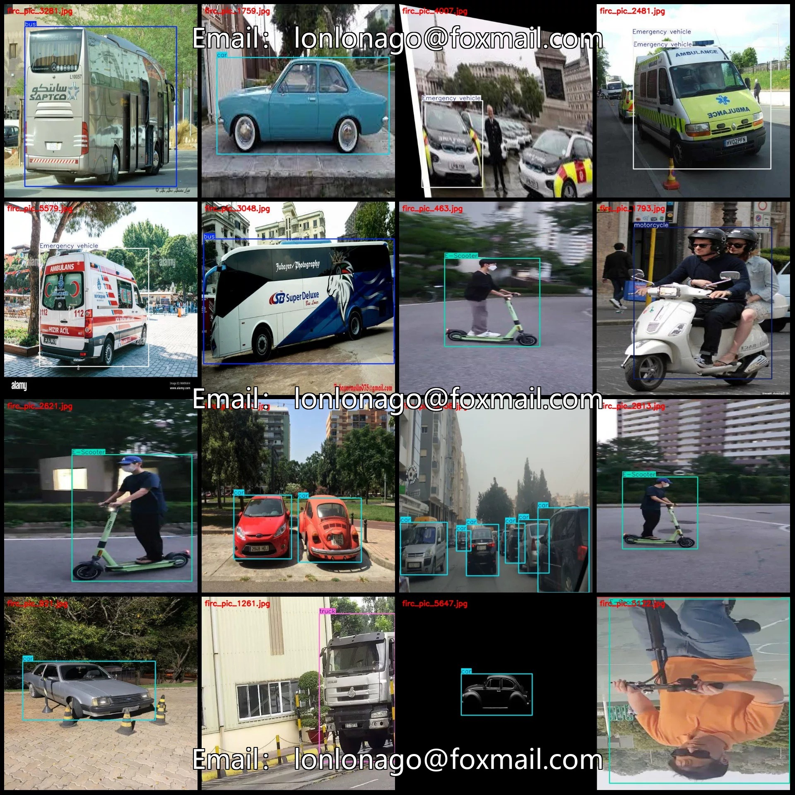
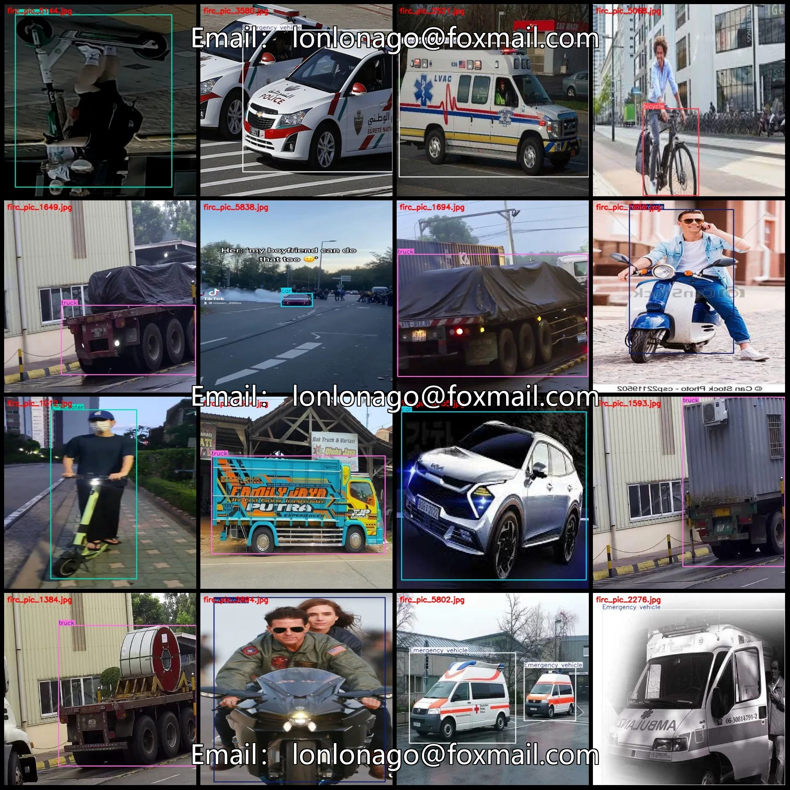
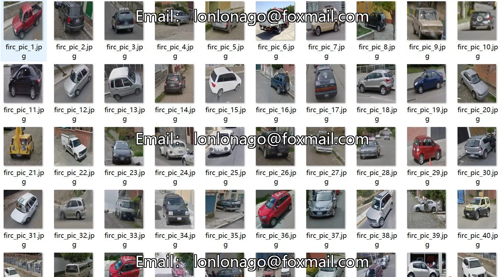
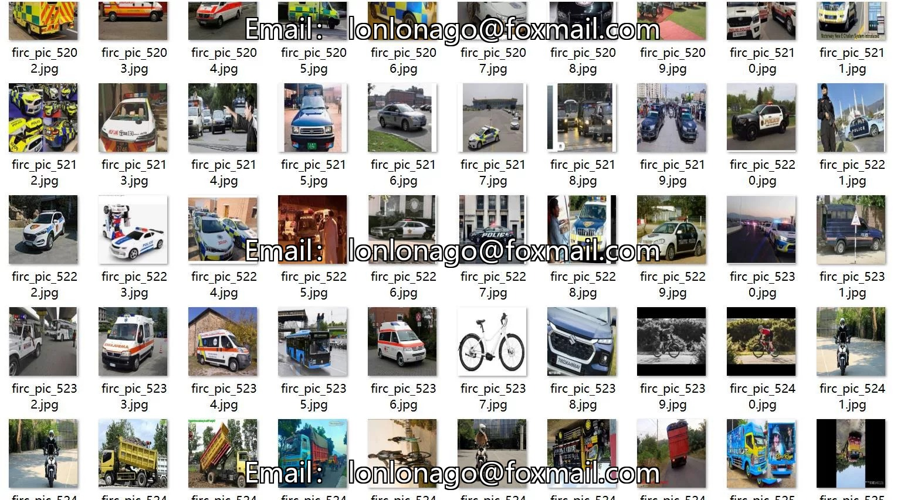
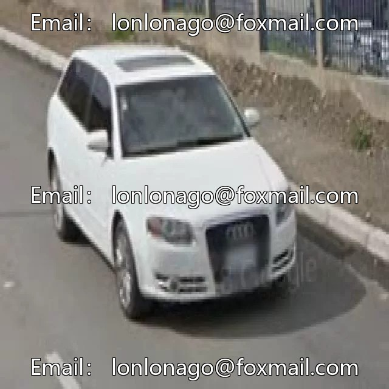
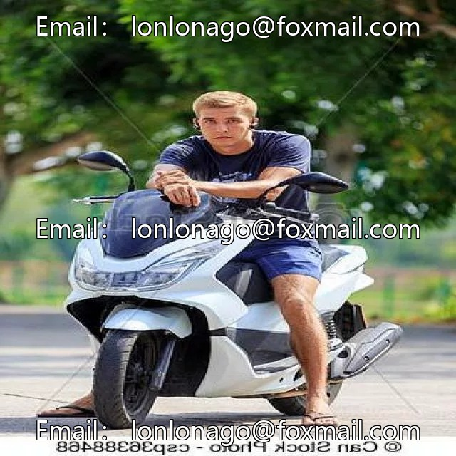
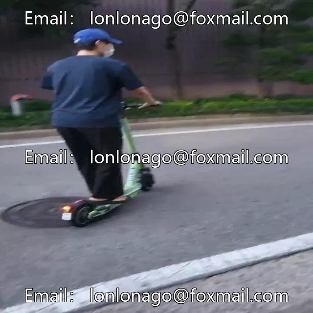

# Vehicle identification dataset for public buses, bicycles, motorcycles, emergency vehicles, skateboards, scooters

## Body

Transportation Vehicle Identification: Car, Bus, Bicycle, Motorcycle, Emergency Vehicle, Scooter, Skateboard
Dataset format: Pascal VOC + YOLO (txt files without split paths, only containing jpg images and corresponding VOC-format xml files and yolo-format txt files)
Number of images (number of jpg files): 5877
Number of annotations (number of xml files): 5877
Number of annotations (number of txt files): 5877
Number of annotation categories: 7

Annotation categories (Note that the order of yolo format categories does not correspond to this, but is based on the labels folder's classes.txt): ["E-Scooter", "Emergency vehicle", "bicycle", "bus", "car", "motorcycle", "truck"]
Number of bounding boxes and image counts per category:
E-Scooter (electric scooter) = 934 bounding boxes, 917 images
Emergency vehicle (emergency vehicle) = 1132 bounding boxes, 1020 images

Bicycle (747 frames)
Bus (624 frames)
Car (1223 frames)
Motorcycle (1078 frames)
Truck (1276 frames)
Total number of frames: 7014
Image resolution: 640x640
Labeling tool used: labelImg
Labeling rules: Draw a rectangle around the category.
Important note: The dataset does not have separate training, validation, and test sets; you will need to partition them yourself.

Special : This dataset does not guarantee the accuracy of the trained models or weight files.

## Images

## Payment

Here is a pay link on Stripe ( https://buy.stripe.com/3cs8yP7sY87d0vu9AB ). Please contact me lonlonago@foxmail.com after funding $89, and I will send you a complete data files , thank you!

